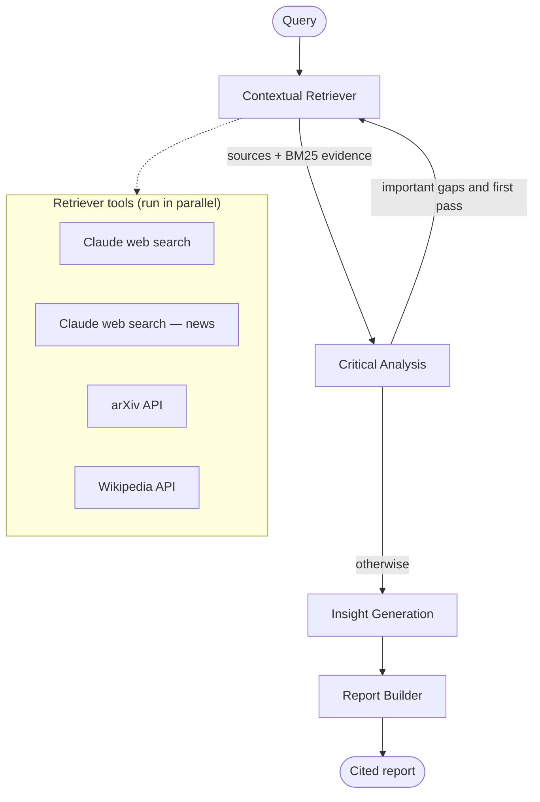

# Lumen — Multi-Agent Deep Researcher

Lumen turns a hard question into a cited research report in a few minutes. Four cooperating agents, orchestrated as a
**LangGraph** state machine and powered by **Claude Opus 5.5**, break the question down, search the web, news, arXiv and
Wikipedia in parallel, rank evidence with **BM25**, cross-check sources for contradictions and credibility, loop back
for targeted follow-up searches when they find important gaps, form calibrated hypotheses, and write a structured
report with inline citations. Every step streams live to a Linear-style workspace, so you can watch the agents work.

> Live demo: _add your Vercel URL here_ · Demo video: _add link here_

## Architecture



- **Graph:** `lib/graph/graph.ts` builds a `StateGraph` over a typed `Annotation.Root` state (`lib/graph/state.ts`).
  Reducers append retrieval results across passes, replace analysis outputs, and sum token usage.
- **Multi-hop:** `lib/graph/routing.ts` — a pure conditional edge after Critical Analysis. It routes back to the
  Retriever only when there are high-importance gaps and the follow-up pass has not been used (max two retrieval passes).
- **Streaming:** agents emit typed events (`lib/events/types.ts`) through LangGraph's custom stream
  (`streamMode: "custom"`); `app/api/research/route.ts` forwards them to the browser as Server-Sent Events.
- **Structured output:** every agent except the report prose uses Zod schemas with
  `withStructuredOutput(schema, { method: "jsonSchema" })` (Claude structured outputs).
- **Safety:** retrieved content is wrapped as untrusted data and the prompts tell agents never to follow instructions
  inside it; model-cited source ids are validated against real sources.

## The four agents

| Agent                | File                      | What it does                                                                                                                                                                                                                                                                                                                                      |
| -------------------- | ------------------------- | ------------------------------------------------------------------------------------------------------------------------------------------------------------------------------------------------------------------------------------------------------------------------------------------------------------------------------------------------- |
| Contextual Retriever | `lib/agents/retriever.ts` | Splits the query into 3–5 sub-questions; runs Claude web search (`web_search_20260209`), a news-focused search, arXiv and Wikipedia in parallel; dedupes, caps sources (~12–15) with a balanced mix, chunks text and ranks chunks per sub-question with LangChain's `BM25Retriever`. On the follow-up pass it turns gaps into targeted questions. |
| Critical Analysis    | `lib/agents/analyst.ts`   | Summarises evidence per sub-question, labels claims Corroborated / Single-source / Disputed, flags contradictions (both claims and source ids), scores credibility (type, domain, recency, model judgement, corroboration) and lists gaps by importance.                                                                                          |
| Insight Generation   | `lib/agents/insight.ts`   | Reasons step by step to produce 3–5 hypotheses with High/Medium/Low confidence, the reasoning chain and evidence ids.                                                                                                                                                                                                                             |
| Report Builder       | `lib/agents/reporter.ts`  | Writes Executive Summary, Key Findings, Contradictions & Open Questions, Insights & Hypotheses with `[n]` citations; Methodology (including failed sources) and References are generated deterministically.                                                                                                                                       |

## Setup

```bash
git clone https://github.com/skachru/AI-Deep-Researcher.git && cd AI-Deep-Researcher
npm install
cp .env.example .env.local   # then add your ANTHROPIC_API_KEY
npm run dev                   # http://localhost:3000
```

Other scripts:

| Command                                                 | Purpose                                                                                                         |
| ------------------------------------------------------- | --------------------------------------------------------------------------------------------------------------- |
| `npm run research -- "question" [--standard]`           | Run the graph from the terminal and print every event                                                           |
| `npm run record [-- "question"]`                        | Record full runs to `public/demo/<slug>.json` (all three examples by default)                                   |
| `npm test`                                              | Vitest: routing logic, tool parsers (mocked network), reducer, report helpers, end-to-end graph with mocked LLM |
| `npm run lint` · `npm run typecheck` · `npm run format` | Code quality                                                                                                    |

## Environment variables

| Variable                | Required | Description                                                                                                                                                |
| ----------------------- | -------- | ---------------------------------------------------------------------------------------------------------------------------------------------------------- |
| `ANTHROPIC_API_KEY`     | Yes      | The only key needed. arXiv and Wikipedia are free; web search runs through Claude. Web search must be enabled for your organisation in the Claude Console. |
| `LUMEN_MODEL`           | No       | Defaults to `claude-opus-5-5`.                                                                                                                             |
| `NEXT_PUBLIC_DEMO_MODE` | No       | `true` makes the example chips replay recorded runs instantly.                                                                                             |

Variables are validated with Zod on first use (`lib/env.ts`), so a missing key produces a clear error instead of a crash.

## Demo mode

1. `npm run record` with your API key set. It runs the three example queries and saves the event streams to
   `public/demo/`. Commit those files.
2. Set `NEXT_PUBLIC_DEMO_MODE=true` to make the example chips replay recordings with realistic, compressed timing.
3. Even with demo mode off, if a live run fails or times out and a recording exists for that query, the UI replays it
   automatically and shows a "Replaying recorded run" badge. Live runs always remain available.

## Deploy to Vercel

1. Push this repo to GitHub and import it at [vercel.com/new](https://vercel.com/new) (framework: Next.js, defaults are fine).
2. Add `ANTHROPIC_API_KEY` (and optionally `NEXT_PUBLIC_DEMO_MODE=true`) under **Settings → Environment Variables**.
3. Deploy. The research route sets `maxDuration = 300` seconds, the maximum on the Hobby plan with Fluid compute
   (enabled by default). On Pro you can raise it to 800 in `app/api/research/route.ts`.

Quick depth is designed to finish well inside 300 seconds: tools run in parallel with per-call timeouts and retries,
sources are capped, every agent has a token cap and a low effort setting, and the server aborts cleanly 15 seconds
before the platform limit.

## Screenshots

_Add screenshots of the home page, live workspace and report here._

## Limitations

- Web search returns the passages Claude cited, not full page text, so evidence from web pages is excerpt-level.
- Credibility scoring is heuristic plus model judgement; it is a guide, not a fact-check.
- Standard depth can approach the 300-second Hobby limit on complex questions.
- No persistence: runs are not saved beyond the browser session (except recordings).

## Future scope

- PDF and document upload as additional sources
- More sources (Semantic Scholar, PubMed, news APIs) and full-page fetching
- A vector store for semantic retrieval alongside BM25
- Saved research history and team collaboration (shared workspaces, comments)
- PDF export of reports
