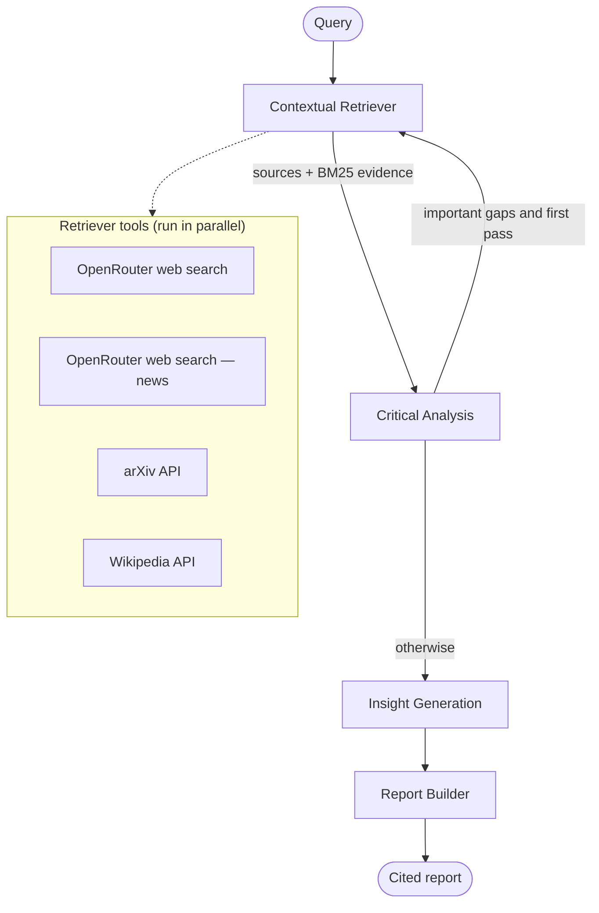

# Lumen — Multi-Agent Deep Researcher

Lumen turns a hard question into a cited research report in a few minutes. Four cooperating agents, orchestrated as a
**LangGraph** state machine and powered by any LLM on **OpenRouter**, break the question down, search the web, news, arXiv and
Wikipedia in parallel, rank evidence with **BM25**, cross-check sources for contradictions and credibility, loop back
for targeted follow-up searches when they find important gaps, form calibrated hypotheses, and write a structured
report with inline citations. Every step streams live to a Linear-style workspace, so you can watch the agents work.

> Live demo: _add your Vercel URL here_ · Demo video: _add link here_

## Architecture



- **Graph:** `lib/graph/graph.ts` builds a `StateGraph` over a typed `Annotation.Root` state (`lib/graph/state.ts`).
  Reducers append retrieval results across passes, replace analysis outputs, and sum token usage.
- **Multi-hop:** `lib/graph/routing.ts` — a pure conditional edge after Critical Analysis. It routes back to the
  Retriever only when there are high-importance gaps and the follow-up pass has not been used (max two retrieval passes).
- **Streaming:** agents emit typed events (`lib/events/types.ts`) through LangGraph's custom stream
  (`streamMode: "custom"`); `app/api/research/route.ts` forwards them to the browser as Server-Sent Events.
- **Structured output:** every agent except the report prose uses Zod schemas with
  `withStructuredOutput(schema, { method: "jsonSchema" })` (structured outputs via OpenRouter `response_format`, with `provider.require_parameters` so requests only go to providers that support it).
- **Safety:** retrieved content is wrapped as untrusted data and the prompts tell agents never to follow instructions
  inside it; model-cited source ids are validated against real sources.

## The four agents

| Agent                | File                      | What it does                                                                                                                                                                                                                                                                                                                                                            |
| -------------------- | ------------------------- | ----------------------------------------------------------------------------------------------------------------------------------------------------------------------------------------------------------------------------------------------------------------------------------------------------------------------------------------------------------------------- |
| Contextual Retriever | `lib/agents/retriever.ts` | Splits the query into 3–5 sub-questions; runs OpenRouter web search (the `openrouter:web_search` server tool), a news-focused search, arXiv and Wikipedia in parallel; dedupes, caps sources (~12–15) with a balanced mix, chunks text and ranks chunks per sub-question with LangChain's `BM25Retriever`. On the follow-up pass it turns gaps into targeted questions. |
| Critical Analysis    | `lib/agents/analyst.ts`   | Summarises evidence per sub-question, labels claims Corroborated / Single-source / Disputed, flags contradictions (both claims and source ids), scores credibility (type, domain, recency, model judgement, corroboration) and lists gaps by importance.                                                                                                                |
| Insight Generation   | `lib/agents/insight.ts`   | Reasons step by step to produce 3–5 hypotheses with High/Medium/Low confidence, the reasoning chain and evidence ids.                                                                                                                                                                                                                                                   |
| Report Builder       | `lib/agents/reporter.ts`  | Writes Summary, Key Findings, Contradictions & Open Questions, Insights & Hypotheses with `[n]` citations; Methodology (including failed sources) and References are generated deterministically.                                                                                                                                                                       |

## Setup

```bash
git clone https://github.com/skachru/AI-Deep-Researcher.git && cd AI-Deep-Researcher
npm install
cp .env.example .env.local   # then add your OPENROUTER_API_KEY
npm run dev                   # http://localhost:3000
```

Other scripts:

| Command                                                 | Purpose                                                                                                         |
| ------------------------------------------------------- | --------------------------------------------------------------------------------------------------------------- |
| `npm run research -- "question" [--standard]`           | Run the graph from the terminal and print every event                                                           |
| `npm run record [-- "question"]`                        | Record full runs to `public/demo/<slug>.json` (all three examples by default)                                   |
| `npm test`                                              | Vitest: routing logic, tool parsers (mocked network), reducer, report helpers, end-to-end graph with mocked LLM |
| `npm run lint` · `npm run typecheck` · `npm run format` | Code quality                                                                                                    |

## Environment variables

| Variable                                                     | Required           | Description                                                                                                                                                                                  |
| ------------------------------------------------------------ | ------------------ | -------------------------------------------------------------------------------------------------------------------------------------------------------------------------------------------- |
| `OPENROUTER_API_KEY`                                         | Yes                | The only key needed (openrouter.ai/keys). arXiv and Wikipedia are free; web search runs through OpenRouter's web search tool (billed per result by OpenRouter).                              |
| `OPENROUTER_MODEL`                                           | No                 | Any OpenRouter model id with structured outputs + tools. Defaults to `qwen/qwen3.8-flash` (low cost). `/setup` shows its price and capabilities.                                             |
| `NEXT_PUBLIC_DEMO_MODE`                                      | No                 | `true` makes the example chips replay recorded runs instantly.                                                                                                                               |
| `DATABASE_URL`                                               | For history        | Postgres (Neon). Enables per-user history, the admin dashboard and rate limits. Tables are created automatically on first use.                                                               |
| `AUTH_SECRET`                                                | For sign-in        | 32+ random characters for signing sessions (`openssl rand -base64 48`).                                                                                                                      |
| `GOOGLE_CLIENT_ID` `GOOGLE_CLIENT_SECRET`                    | For Google sign-in | OAuth client ("Web application") from Google Cloud. Redirect URI: `https://<domain>/api/auth/google/callback`.                                                                               |
| `OPENROUTER_REASONING`                                       | No                 | `auto` (default) switches "thinking" off on reasoning models (or keeps it low where mandatory) so runs stay inside the time limit. Set `low`/`medium`/`high` for more depth on a fast model. |
| `APP_URL`                                                    | No                 | Pins the public URL used for the Google redirect (otherwise taken from the request).                                                                                                         |
| `ADMIN_EMAILS`                                               | No                 | Comma-separated admin emails. Defaults to `skachru@gmail.com`.                                                                                                                               |
| `SMTP_HOST` `SMTP_PORT` `SMTP_USER` `SMTP_PASS` `EMAIL_FROM` | For email          | Any SMTP provider. Gmail: `smtp.gmail.com`, port `465`, your address and a Google [app password](https://myaccount.google.com/apppasswords).                                                 |
| `RUNS_PER_HOUR` `RUNS_PER_IP_HOUR` `RUNS_PER_DAY`            | No                 | Research limits: per visitor per hour (10), per IP per hour (20), whole site per day (300). Admins are exempt.                                                                               |
| `EMAILS_PER_DAY` `EMAILS_PER_IP_DAY` `EMAILS_GLOBAL_DAY`     | No                 | Email limits: per visitor (10), per IP (20), whole site (200) per day.                                                                                                                       |

Variables are validated with Zod on first use (`lib/env.ts`), so a missing key produces a clear error instead of a crash.

## Accounts, history, email and admin

- **Quick summary in seconds:** `lib/graph/run.ts` streams a short preliminary answer token by token _alongside_ the
  LangGraph run (not as a node, so it can never delay the agents). When the report is ready it is replaced by the
  source-verified `## Summary`.
- **History:** every browser gets an anonymous id (httpOnly cookie), so `/history` works without sign-up. Signing in with
  **Google** (OAuth code flow with PKCE; ID token verified against Google's keys) or an emailed one-time link attaches
  that history to the account and syncs it across devices.
- **Reliability panel:** every report (UI, HTML, PDF) opens with its evidence strength (Strong / Moderate / Limited), the
  share of corroborated vs disputed claims and the source mix. Sources show thumbnails (Wikipedia images, page preview
  images fetched through an SSRF-guarded `/api/og`, or the site icon).
- **Downloads and print:** a single Download menu offers PDF, interactive HTML and Markdown (`POST /api/export`; the PDF is
  rendered server-side with pdfmake). The HTML (`lib/report/interactive.ts`) is a self-contained page with key takeaways,
  an evidence ring, claim filters, citation previews that jump to the source, source filters, dark mode and print; all
  report text is sanitised because it derives from web content. **Print** prints that designed report, not the app.
- **Report length:** Short, Medium or Full length next to Quick/Standard. Short and Medium ask the Report Builder for a
  brief of roughly 100 or 250 words (Summary and Key Findings, plus brief Contradictions and Insights for Medium) and
  skip the Methodology section; References are always included.
- **Share:** opens with an editable message (greeting, context, headline findings, sign-off) and the report as PDF and
  interactive HTML. Files are truly attached in three ways: **Send by email** (signed-in users; Lumen sends it over SMTP
  with both files, Reply-To the sender; `POST /api/email`, max 5 recipients, rate-limited), the system **share sheet**
  where the browser can share files, and **Email app**, which saves an unsent `.eml` draft with both files for Outlook,
  Apple Mail or Thunderbird. WhatsApp, Telegram, Gmail and Outlook web compose links only carry text, so for those the
  files are downloaded to attach by hand. Links shared by earlier versions (`/share/<id>`) still open.
- **Admin:** `/admin` (only for `ADMIN_EMAILS`) shows searches, success rate, users, average run time, tokens, emails sent,
  searches per day, top questions and recent searches.

Each feature switches on when its environment variables are set; without them the app still runs research.

**Safety and cost controls.** Research, email, export, sign-in and preview-image requests are rate-limited per visitor,
per IP and (for paid operations) site-wide. Limits use an atomic Postgres counter (`rate_limits` table) and fall back to
an in-memory counter when no database is configured or it is unreachable — they are never switched off. Report claims
are re-labelled from the validated evidence ("Corroborated" needs two different sites), citations to non-existent
sources are removed, post-sign-in redirects only allow same-site paths, and the preview-image fetcher pins every
connection to an address it has verified is public (no private-network access, including via DNS rebinding).

**Setup check:** open `/setup` on your deployment. Its **speed test** times one structured call and one web search with your model, so you can tell at once whether a model is fast enough. It tests the OpenRouter key (and remaining credit), the chosen model's capabilities, the Google OAuth client ID/secret and
redirect URI (against Google itself), the database and SMTP login, and says exactly what to fix. No secrets are shown;
once someone has signed in, the page is admin-only.

## Demo mode

1. `npm run record` with your API key set. It runs the three example queries and saves the event streams to
   `public/demo/`. Commit those files.
2. Set `NEXT_PUBLIC_DEMO_MODE=true` to make the example chips replay recordings with realistic, compressed timing.
3. Even with demo mode off, if a live run fails or times out and a recording exists for that query, the UI replays it
   automatically and shows a "Replaying recorded run" badge. Live runs always remain available.

## Deploy to Vercel

1. Push this repo to GitHub and import it at [vercel.com/new](https://vercel.com/new) (framework: Next.js, defaults are fine).
2. Add `OPENROUTER_API_KEY` (and optionally `NEXT_PUBLIC_DEMO_MODE=true`) under **Settings → Environment Variables**.
   For history and admin, add a database under **Storage → Create Database → Neon** (it sets `DATABASE_URL`), then add
   `AUTH_SECRET`, `ADMIN_EMAILS` and the `SMTP_*` variables.
3. Deploy. The research route sets `maxDuration = 300` seconds, the maximum on the Hobby plan with Fluid compute
   (enabled by default). On Pro you can raise it to 800 in `app/api/research/route.ts`.

Quick depth is designed to finish well inside 300 seconds: tools run in parallel with per-call timeouts and retries,
sources are capped, every agent has a token cap and a low effort setting, and the server aborts cleanly 15 seconds
before the platform limit.

## Screenshots

_Add screenshots of the home page, live workspace and report here._

## Limitations

- Web search returns excerpts of the pages the model cited, not full page text, so evidence from web pages is excerpt-level.
- Credibility scoring is heuristic plus model judgement; it is a guide, not a fact-check.
- Standard depth can approach the 300-second Hobby limit on complex questions.
- No persistence: runs are not saved beyond the browser session (except recordings).

## Future scope

- PDF and document upload as additional sources
- More sources (Semantic Scholar, PubMed, news APIs) and full-page fetching
- A vector store for semantic retrieval alongside BM25
- Saved research history and team collaboration (shared workspaces, comments)
- PDF export of reports
